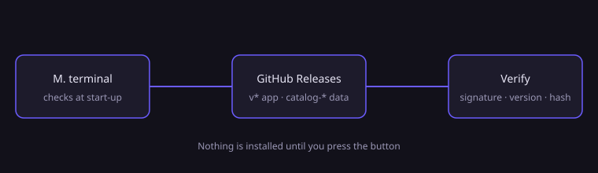
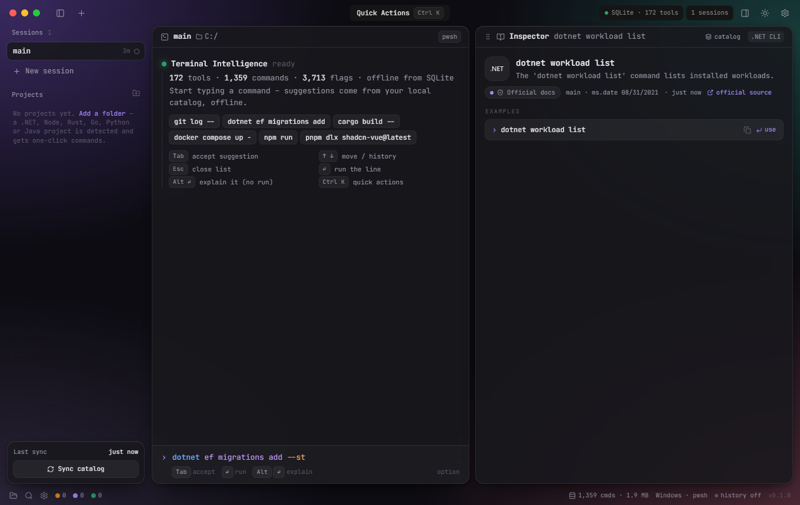
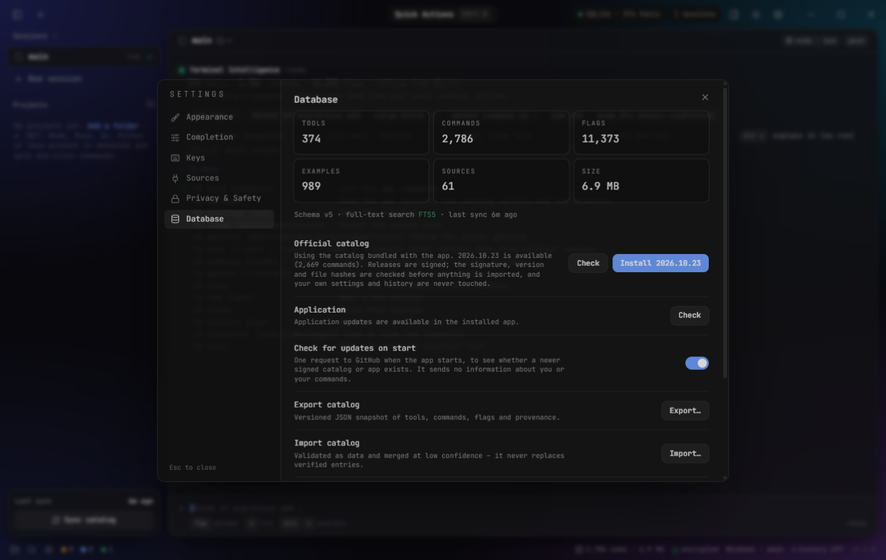
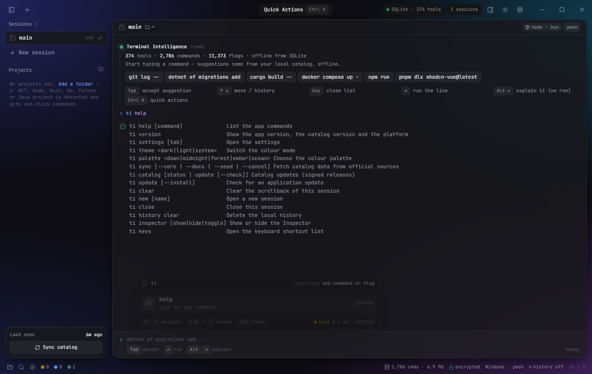
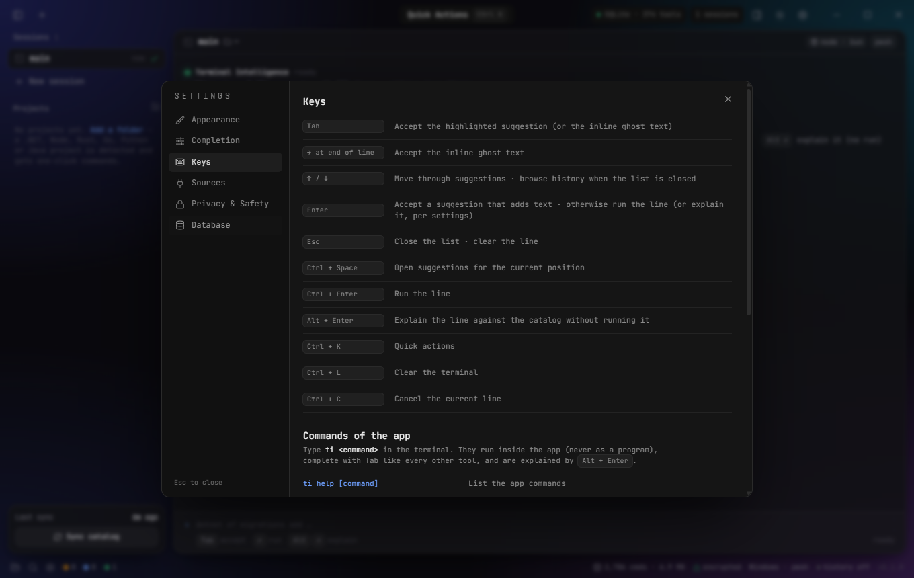

# M. terminal — downloads

Free, offline terminal with command and flag completion. Source code is private; installers and catalog updates are published here.

## Download

Go to **[Releases](../../releases?q=v)** and pick the newest `v*` release (every version stays available):

| System | File |
|---|---|
| Windows 10/11 | `M-terminal-<version>-win-x64.exe` (installer) or `.zip` (portable) |
| Linux | `M-terminal-<version>-linux-x86_64.AppImage`, `.deb`, or `.tar.gz` |

*Status: no `v*` app release has been published yet — the first one will appear here when the app is final.*

## Updates (automatic, and always your choice)

**1. Command catalog.** The app looks at this page **once a day** (and at start-up) for the newest `catalog-*` release. If there is one, you get a message — *"Catalog … is available"* — and the sidebar button shows the new version. Press **Update catalog** (bottom of the sidebar): the app downloads, verifies and installs it in a few seconds. Or open **Settings → Database → Official catalog → Install**. The catalog is signed (Ed25519); the app checks the signature, version and file hashes before importing, and never touches your settings or history. Or type `ti catalog update` in the terminal.

**2. The app itself.** **Settings → Database → Application → Check**, then **Download** and **Restart and update**. Or `ti update --install`. (Store versions are updated by the store.)

**Turn it off:** Settings → Database → *Check for updates on start* (this also stops the daily check). The request sends nothing about you or your commands.

**Manual install of a catalog:** not needed — the app downloads it for you.

## Screenshots

**Completion from the local catalog (offline)**

**Updates: Settings → Database** — the signed catalog and the app, each with its own Check / Install button, plus the start-up check switch

**Commands of the app itself** — type `ti help`

**Settings → Keys** lists the shortcuts and the app commands

